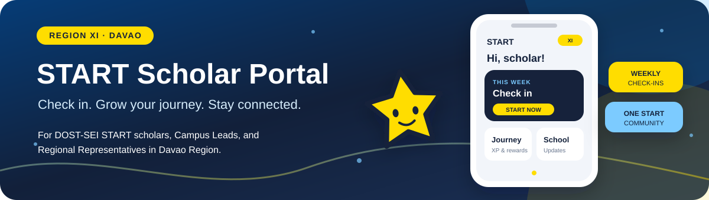
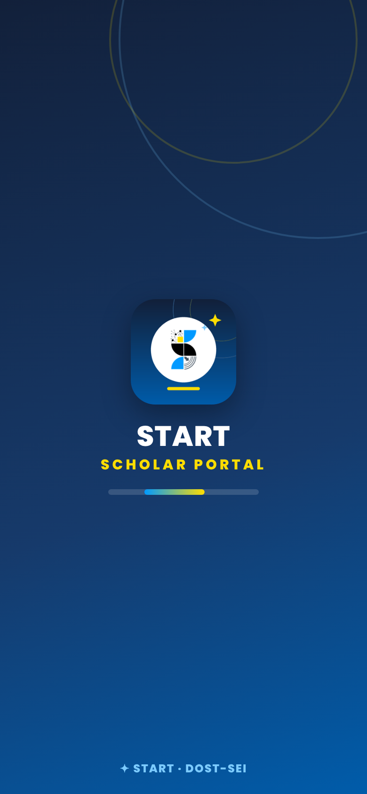
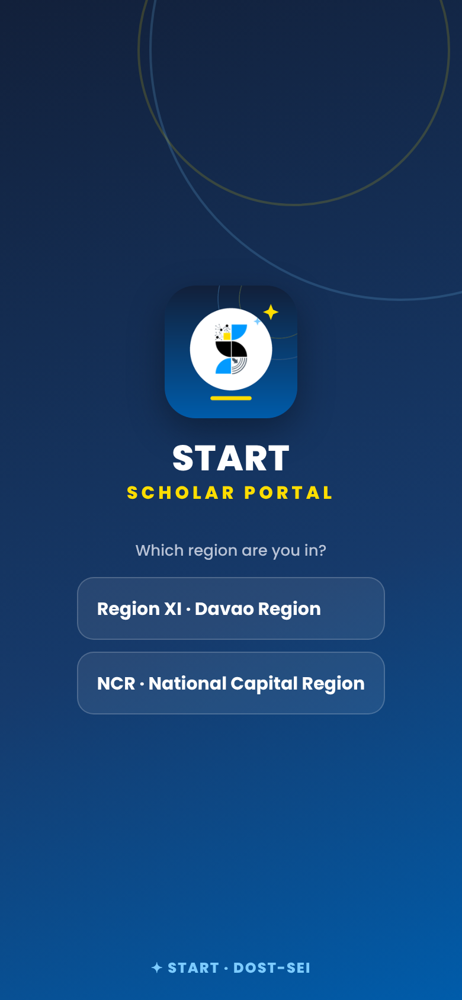
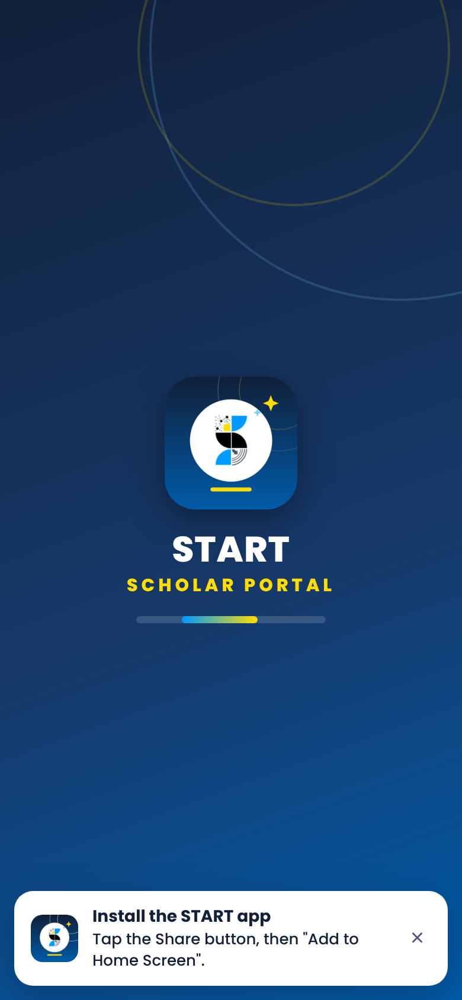
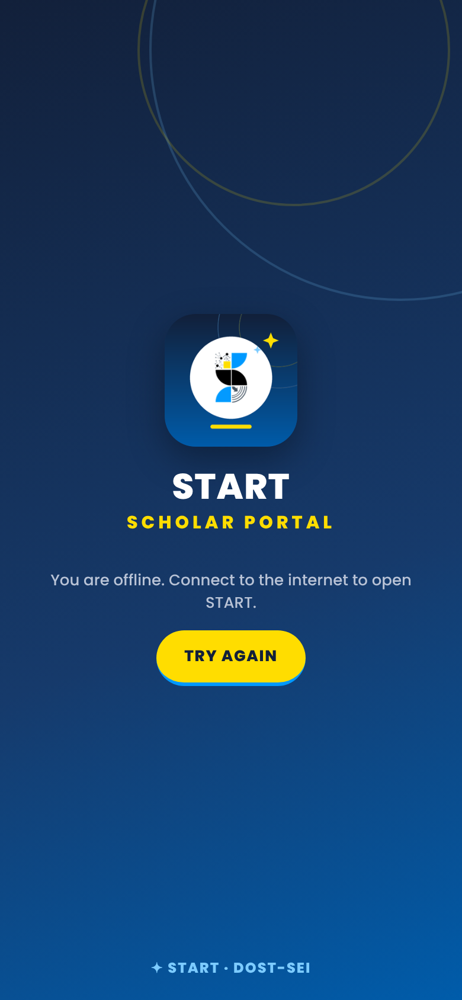
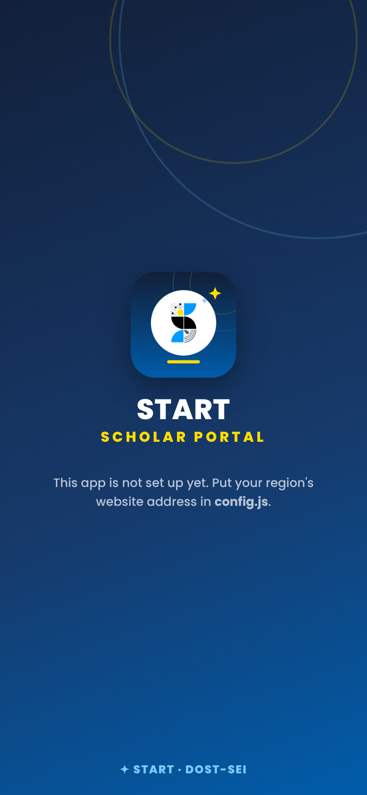
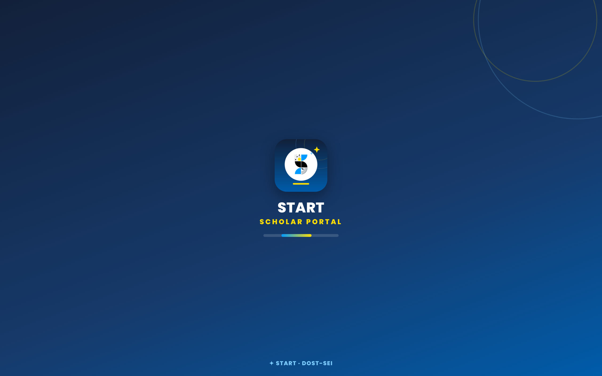
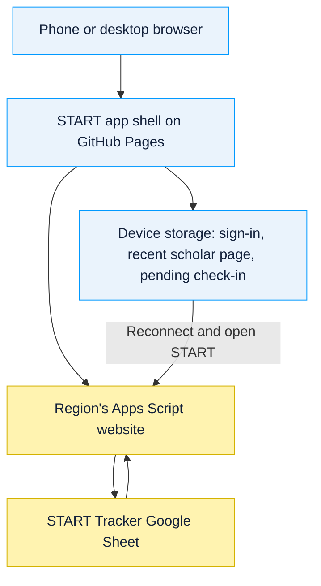

  

<h1 align="center">START Scholar Portal</h1>

One place for DOST-SEI START scholars, Campus Leads, and Regional Representatives in Davao Region. Check in each week, follow your Journey, and stay connected to your school.

<code>Region XI · Davao</code> &nbsp; <code>Web / PWA</code> &nbsp; <code>GitHub Pages</code> &nbsp; <code>Google Sheets + Apps Script</code>

  <a href="https://feliciety02.github.io/START-Davao-Chapter/"><strong>Open the app</strong></a> &nbsp;·&nbsp;
  <a href="#app-tour"><strong>App tour</strong></a> &nbsp;·&nbsp;
  <a href="#how-it-works"><strong>How it works</strong></a> &nbsp;·&nbsp;
  <a href="#install-start"><strong>Install START</strong></a> &nbsp;·&nbsp;
  <a href="#set-up-a-region"><strong>Set up a region</strong></a>

The installable app is hosted on GitHub Pages. It opens the START website from the region's Google Apps Script deployment, which uses the START Tracker spreadsheet. The app shell works on phones and computers without an app store. It caches the shell for weak connections and can keep a scholar's recent page and an unsent weekly check-in on their device.

## At a glance

<table>
  <tr>
    <td align="center" width="25%"><strong>01 · Weekly check-ins</strong> One question at a time, with an offline answer option</td>
    <td align="center" width="25%"><strong>02 · Journey</strong> Brain breaks, XP, progress, and reward requests</td>
    <td align="center" width="25%"><strong>03 · Campus Leads</strong> School updates, events, and scholar follow-up</td>
    <td align="center" width="25%"><strong>04 · Regional Representatives</strong> Registration, schools, outreach, events, and settings</td>
  </tr>
</table>

Scholars can sign in with their START account. New eligible scholars can register from the portal; requests that need review go to the Regional Representative. Campus Lead and Regional Representative pages use their assigned access in the tracker.

## App tour

These screenshots show **the app shell's own screens**, including loading, installation, and offline states. The signed-in START website fills the screen after loading. The captures are illustrative and may differ from the latest local UI; select an image to open it at full size.

<table>
  <tr>
    <td align="center"> <strong>1 · Opening</strong> Loads the selected region</td>
    <td align="center"> <strong>2 · Region picker</strong> Appears when multiple regions are configured</td>
    <td align="center"> <strong>3 · Install hint</strong> Phone-specific home screen steps</td>
  </tr>
  <tr>
    <td align="center"> <strong>4 · Offline</strong> Recent scholar page and retry action</td>
    <td align="center"> <strong>5 · Setup needed</strong> Shown when the region URL is missing</td>
    <td align="center"> <strong>6 · Desktop</strong> The same app shell on a larger screen</td>
  </tr>
</table>

## How it works

The tracker spreadsheet is the source of truth. GitHub Pages hosts static app files; account, school, event, and check-in data are handled by each region's Apps Script and tracker. The device may retain a sign-in, a recent scholar page, and an unsent check-in. **Sign out** removes the saved page and pending check-in from that device. An offline check-in is sent when the scholar is signed in and opens START with a connection.

The app shell can open without a connection after it has been cached. Live pages, brain breaks, and new data still need internet access.

## Install START

Open the [Region XI app](https://feliciety02.github.io/START-Davao-Chapter/) in a browser. The app shows an install reminder when the browser supports one; installation always needs the person's approval.

| Device | Steps |
| --- | --- |
| Android · Chrome | Tap **Install** in START, or use **⋮ → Install app**. |
| iPhone · Safari | Tap **Share → Add to Home Screen**. |
| Computer · Chrome or Edge | Use the install icon in the address bar. |

START is a web app. This repository does not contain an Android APK or an iOS App Store build.

## Explore the repository

| Area | Start here | What you will find |
| --- | --- | --- |
| Installable app | [index.html](index.html) · [config.js](config.js) | Loading, region selection, offline check-in, and the region website frame |
| Install assets | [manifest.webmanifest](manifest.webmanifest) · [sw.js](sw.js) · [icons/](icons/) | App identity, service worker cache, and generated icons |
| Tracker website and backend | [apps-script/](apps-script/) | Portal UI, registration, check-ins, roles, events, email, and spreadsheet setup |
| Local checks | [apps-script/tests/](apps-script/tests/) | Node tests for portal and tracker behavior |
| Screenshots | [docs/screenshots/](docs/screenshots/) | App shell captures used in the tour |

## Set up a region

The checkout already names Region XI in [config.js](config.js). For a new region or a fork, set up the tracker website and app address together:

1. In the region's bound Apps Script project, deploy the START website as a **Web app** with **Who has access: Anyone**. A website that requires a Google sign-in cannot load inside the app frame.
2. Put the deployment's `/exec` URL in the `regions` list in [config.js](config.js). With more than one region, START asks the visitor to choose one and remembers the selection.
3. Publish the root app files, including `.nojekyll` and `icons/`, through GitHub Pages: **Settings → Pages → Deploy from a branch → main → / (root)**.
4. In each tracker, open **START Tracker → 🌐 Website for members, Leads & you**. Enter the published app URL under **📱 START app address** and save it. This allows the website to appear inside the app.

The [Apps Script guide](apps-script/README.md) covers tracker setup, schema changes, and deployment details. Editing local `.gs` or `Web_App.html` files does **not** change the live bound Apps Script project.

## Updating and checking

- **App shell, configuration, or icons:** publish the changed root files to GitHub Pages. Installed devices load the updated shell when they next open START online. If the icon remains old, reinstalling the home screen app may be necessary.
- **Tracker website or server:** copy or sync the changed files from [apps-script/](apps-script/) into the bound project, run **Set up / fix the tracker** as the owner when schema or protections changed, then deploy a **new web-app version**. Keep the live project's complete `07_Look.gs` when syncing.
- **Icons:** run `powershell -NoProfile -ExecutionPolicy Bypass -File ./icons/build-icons.ps1`, then publish the generated files in `icons/` and the manifest.
- **Local checks:** run `node --test apps-script/tests/*.test.cjs` from the repository root.

Local tests cannot verify live Google Sheets permissions, email delivery, or Apps Script response time. After a deployment, test registration, sign-in, one check-in, and the installed app on real Android and iPhone devices.
