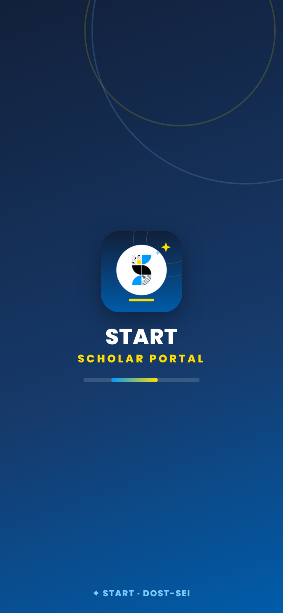
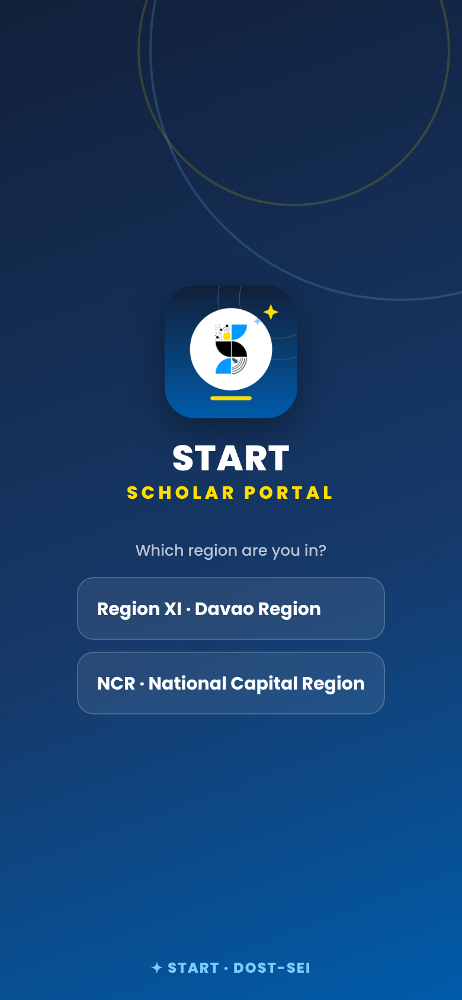
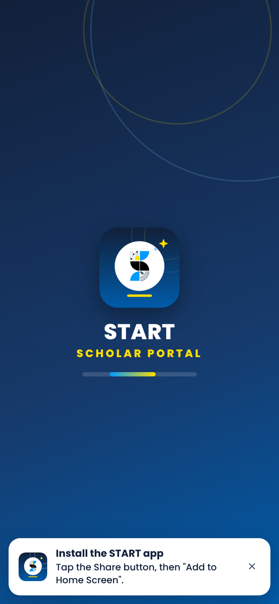
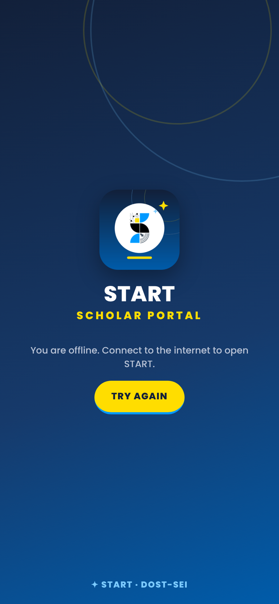
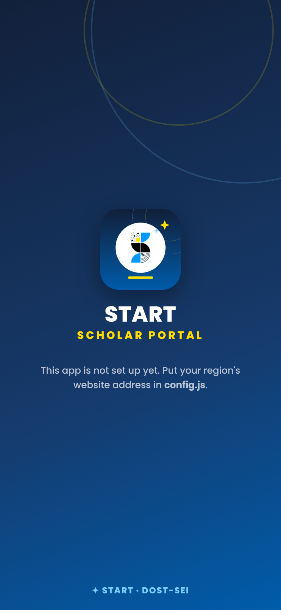
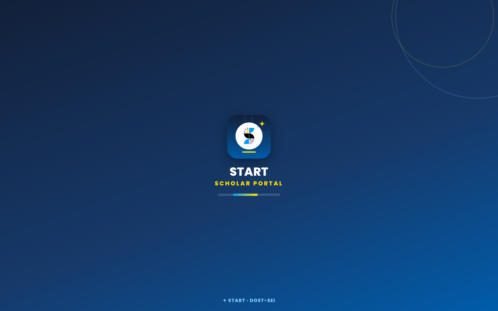

# START Scholar Portal app

The START app for DOST-SEI START scholars, START Campus Leads and Regional Representatives (RRs).
It is a free installable web app, hosted on GitHub Pages, with no app store. It opens your region's
START website, which runs on the START Tracker Google Sheet and Apps Script.

- No data is stored here. Everything stays in each region's tracker spreadsheet.
- The app keeps only your sign-in on your own phone, so you don't type a code every time.
- It has its own icon, name and full-screen look, and a navy and yellow loading screen.

**Live app (Region XI · Davao Region):** https://feliciety02.github.io/start-app/

## Screenshots

| Loading screen | Choosing a region | Install hint (iPhone) |
|---|---|---|
|  |  |  |
| Shown while your region's website loads. | Only appears when `config.js` lists more than one region. | iPhones get these steps; Android and computers get an **Install** button. |

| Offline | Not set up yet |
|---|---|
|  |  |
| No internet: the app waits and offers **Try again**. | `config.js` still has the placeholder address. |

On a computer:

The screenshots show the app's own screens. Once the website loads, it fills the whole screen.

## Set up (once, about 10 minutes)

### 1. Put the files on GitHub
1. On github.com, click **New repository**. Name it `start-app`, set it to **Public**, then click **Create repository**.
2. Click **uploading an existing file**. Drag in **everything inside this folder**, including the `icons` folder and the
   hidden `.nojekyll` file, then click **Commit changes**.
3. Go to **Settings › Pages**. Set Source to **Deploy from a branch**, Branch to **main**, folder **/ (root)**, then click **Save**.
4. After about a minute, the page shows your app address, for example `https://yourname.github.io/start-app/`.

### 2. Point the app at your region's website
1. In GitHub, open `config.js` and click ✏️ (edit).
2. Replace `https://script.google.com/macros/s/PASTE_YOUR_WEBSITE_ID/exec` with your website address.
   To find it, open the tracker and go to **START Tracker › 🌐 Website for members, Leads & you**.
3. Click **Commit changes**. For more regions, add one line per region; the app then asks members once which region they're in.

### 3. Allow the app in each tracker
1. In each tracker, open **START Tracker › 🌐 Website for members, Leads & you**.
2. Paste the app address in **📱 START app address** and click **Save**.

Without this step, Google won't let the website show inside the app.

The website must be deployed with **Who has access: Anyone**. A website that needs a Google sign-in can't be shown inside the app.

## Installing on a phone
- **Android (Chrome):** open the app address. Tap **Install** on the white bar, or use ⋮ › **Install app**.
- **iPhone (Safari):** open the app address. Tap **Share** ⬆, then **Add to Home Screen**.
- **Computer (Chrome / Edge):** click the install icon in the address bar.

## Files
| File | What it is |
|---|---|
| `index.html` | The app: loading screen, the website inside it, the install bar |
| `config.js` | **The only file to edit**: each region's website address |
| `manifest.webmanifest` | App name, colours and icons |
| `sw.js` | Keeps the app shell so it opens on weak connections |
| `icons/` | App icons (navy, START mark, yellow bar) |
| `docs/screenshots/` | The screenshots in this README |

## Updating
- **The website or tracker changes:** nothing to do here. The app always shows the live website.
- **The app itself changes:** upload the new files. Phones pick them up the next time the app is opened online.

## Change log

### 22 October 2026
- **Screenshots and change log added to this README.** The six screenshots are in `docs/screenshots/`.
- **Website access opened.** The Region XI website deployment is now set to **Who has access: Anyone**. Before this, it sent visitors to a Google sign-in page, which can't be shown inside the app. It now opens directly as *START Scholar Portal · Region XI*.
- **App published.** The repo `Feliciety02/start-app` was created with all the app files. GitHub Pages was turned on (branch `main`, folder `/`), so the app is live at https://feliciety02.github.io/start-app/.
- **Region XI website address set.** In `config.js`, the placeholder `PASTE_YOUR_WEBSITE_ID` was replaced with the Region XI deployment (`AKfycbxpcLEC…XVShWQ`).

### Still to do
- [ ] In the Region XI tracker, open **START Tracker › 🌐 Website for members, Leads & you**, paste `https://feliciety02.github.io/start-app/` into **📱 START app address**, and click **Save**. Until this is done, the website won't show inside the app.
- [ ] Test on an Android phone and an iPhone: open the app, sign in, close it, and open it again.
- [ ] Share the app address and install steps with scholars, Campus Leads and RRs.
